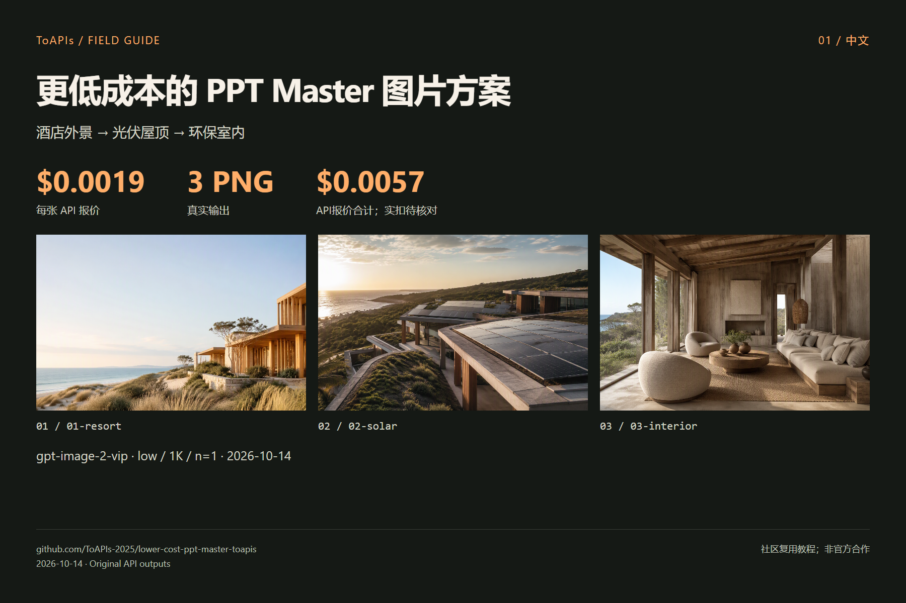

# 更低成本的 PPT Master 图片方案

[English](README.md)

以 ToAPIs `gpt-image-2-vip / low / 1K / n=1` 复用 PPT Master 场景。3 张已完成图片，API 报价合计 **$0.0057**；实扣金额待后台核对。

原 image_gen.py CLI → 新 ToAPIs Backend → 异步图片结果；整套 Agent 生成 PPT 与原生导出未验收。

> 社区教程；未获上游背书。“更低成本”描述本次 API 档位，不表示整个软件或全部模型总成本更低。

## 演示



| 案例 | 原图 | 输出像素 |
|---|---|---|
| 01-resort | [PNG](assets/01-resort.png) | 1536 × 864 |
| 02-solar | [PNG](assets/02-solar.png) | 1536 × 864 |
| 03-interior | [PNG](assets/03-interior.png) | 1536 × 864 |

## 对应模型价格与本次花费

| Model | 配置 | API 单张报价 |
|---|---|---|
| `gpt-image-2-vip` | `low / 1K / n=1` | **$0.0019** |

3 张已完成图片，API 报价合计 **$0.0057**；实扣金额待后台核对。

[API pricing snapshot](evidence/pricing.json) · [Cost record](evidence/costs.json) · [Original requests](evidence/runs.json)

报价核查于 2026-10-14；不含其他画质、分辨率、模型、Agent 或机器成本。

[ToAPIs 模型落地页](https://go2v.toapis.com/1014_pptmaster_lowercost_gh_cn)

## 复现步骤

本机私有环境配置 `TOAPIS_API_KEY`，不要写进源码或聊天。`TOAPIS_BASE_URL=https://toapis.cn`（海外可用 `https://toapis.com`）。

```bash
python -m pip install -r skills/ppt-master/requirements.txt
python skills/ppt-master/scripts/image_gen.py "A coastal eco-resort, no text" --backend toapis --model gpt-image-2-vip --aspect_ratio 16:9 --image_size 1K --output results --filename resort
```

本 fork 已增加 `backend_toapis` 与 CLI 注册；保留上游 MIT、Skill 身份与赞助归属文件。单次 CLI 文生图已验收；manifest 并发、整套 PPTX、Agent 宿主未验收。

```bash
# Inspect without paid calls
python scripts/run_demo.py
# Generate the original cases (charged; exact quote checked first)
python scripts/run_demo.py --live --output results
```

本通用脚本是独立 API 素材脚本；PPT Master 的原 CLI 实测记录单独标注在证据中。

## 接口映射

```text
Authorization: Bearer TOAPIS_API_KEY
POST /v1/uploads/images             # reference PNG -> HTTPS URL
POST /v1/images/generations         # model,prompt,size,resolution,quality,n,reference_images
GET  /v1/images/generations/{id}    # poll the SAME task
completed -> result.data[0].url -> download PNG without the API key
```

生成 POST 不自动重试；轮询超时保留 `.toapis-state` 或 results/private-state 的任务 ID，重新执行同一用例会继续查询。参考改图不等于 mask 局部重绘；本轮没有测试 mask、透明背景、音频或云端视频。

## 上游与许可证

[hugohe3/ppt-master](https://github.com/hugohe3/ppt-master) · [pinned `b6843645`](https://github.com/hugohe3/ppt-master/tree/b6843645766c9ab63a7f1486cfd330d6ad337e99)

[Third-party notices](THIRD_PARTY_NOTICES.md)

[Preserved upstream documentation](README_UPSTREAM.md)
